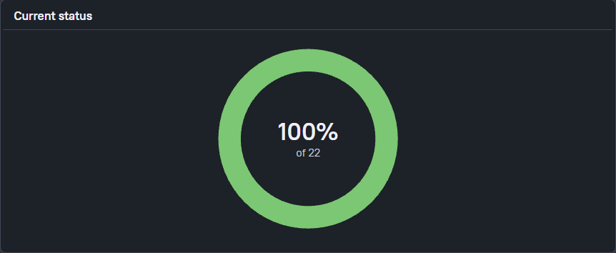
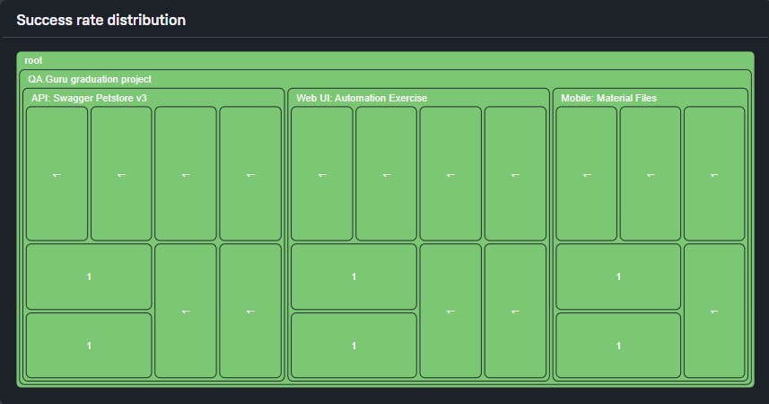
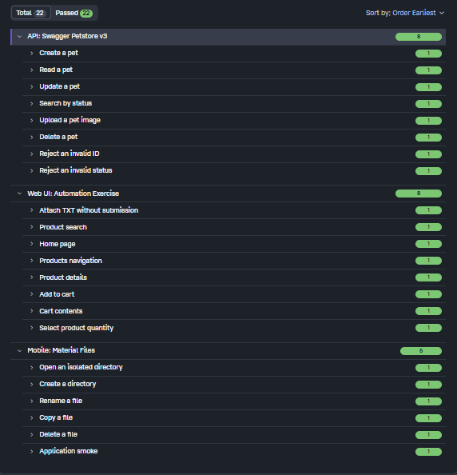
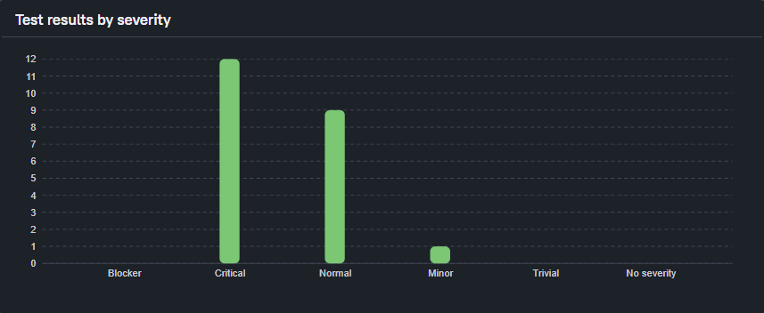

# Дипломный проект по автоматизации тестирования API, Web UI и Mobile

Учебный проект QA.GURU на Python с использованием pytest.
Он объединяет три независимых направления автоматизированного тестирования:
REST API, веб-интерфейс и Android-приложение.

## Тестируемые приложения

| Приложение | Направление |
| --- | --- |
| [Swagger Petstore v3](https://petstore3.swagger.io/) | REST API |
| [Automation Exercise](https://automationexercise.com/) | Веб-приложение |
| [Material Files](https://github.com/zhanghai/MaterialFiles) | Android-приложение |

## Используемые технологии

| Область | Инструменты |
| --- | --- |
| Основа | Python, pytest |
| API | Requests |
| Web UI | Selenium, Selene |
| Mobile | Appium, UiAutomator2, Android Emulator |
| CI и отчёты | Jenkins, Allure Report |
| Управление кодом | Git, GitHub |

## Реализованные автотесты

| Направление | Количество | Проверки |
| --- | ---: | --- |
| API | 8 | CRUD, поиск по статусу, валидация ошибок, загрузка изображения |
| Web UI | 8 | Навигация, поиск, данные товара, гостевая корзина, выбор TXT без отправки формы |
| Mobile | 6 | Главный экран, открытие каталога, создание папки, переименование, копирование и удаление файла |

**Всего — 22 автотеста.** Взаимодействия с интерфейсами вынесены в Page/Screen
Objects; подготовка данных и завершение сессий выполняются через pytest fixtures.

<a id="локальный-запуск"></a>

## Запуск тестов

Команды выполняются из корня проекта в Windows PowerShell.
Проверенная версия Python — 3.14.3; для Web UI нужен установленный Chrome.

```powershell
# Создание окружения и установка зависимостей
py -3.14 -m venv .venv
.\.venv\Scripts\python.exe -m pip install -r requirements.txt

# API
.\.venv\Scripts\python.exe -m pytest tests/api -v

# Web UI — Chrome с окном
.\.venv\Scripts\python.exe -m pytest tests/ui -v

# Mobile — при запущенных Android Emulator и Appium
.\.venv\Scripts\python.exe -m pytest tests/mobile -v
```

Для Web UI без окна перед запуском задайте `$env:HEADLESS = 'true'`.
Для Mobile нужны подготовленный AVD `Pixel_4`, Material Files и Appium
с драйвером UiAutomator2. Порядок подготовки — в [локальной инструкции](docs/local-setup.md).

<a id="jenkins-ci"></a>
<a id="allure-report"></a>

## Jenkins и Allure

Jenkins обнаруживает новые коммиты GitHub через Poll SCM и последовательно
запускает API, Web UI и Mobile. Pipeline публикует JUnit и общий Allure Report
со шагами, вложениями и историей запусков. Jenkins работает локально.

Подробнее: [Allure Report и история](docs/allure-report.md).

## Результаты тестирования

**Jenkins Build #29 — 22 passed / 0 failed / 0 broken.**

API — 8 passed, Automation Exercise — 8 passed, Material Files — 6 passed.
Результат подтверждён на ревизии `bdc9e97ceba5755d77a6f7c30f213517fe1083ca`.

| Общие результаты: 100% из 22 | Три направления: API, Web UI и Mobile |
| :---: | :---: |
|  |  |

### Полный список тестов

Все 22 успешных теста сгруппированы по тестируемым приложениям.



### Приоритеты тестов

**12 Critical, 9 Normal и 1 Minor.**



Скриншоты показывают реальный результат №29. 
