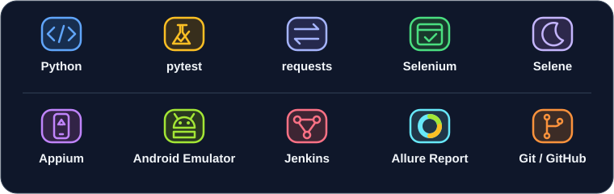
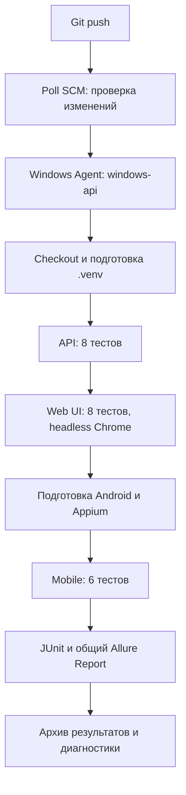

# Дипломный проект QA.GURU

## Автоматизация API, Web UI и Mobile тестирования

Три системы — Swagger Petstore, Automation Exercise и Material Files — в одном проекте на Python и pytest. Независимые наборы тестов, общий Jenkins Pipeline и единая отчётность Allure и JUnit.

**API — 8 · Web UI — 8 · Mobile — 6 · Всего — 22 автотеста**

[Проверки](#реализованные-проверки) · [Локальный запуск](#локальный-запуск) · [Jenkins CI](#jenkins-ci) · [Allure Report](#allure-report) · [Документация](#полезные-ссылки)

## Используемые технологии



| Область | Инструменты и назначение |
| --- | --- |
| Основа | **Python, pytest** — сценарии, фикстуры и проверки |
| API | **requests** — HTTP-клиент и управление сессией |
| Web UI | **Selenium, Selene, Chrome** — действия в браузере и ожидания |
| Mobile | **Appium Python Client, UiAutomator2, Android Emulator** — управление Android-приложением |
| CI и отчёты | **Jenkins, Allure Report, JUnit XML** — запуск, шаги, результаты и диагностика |
| Исходный код | **Git, GitHub** — версионирование и источник Pipeline |

Версии Python-библиотек закреплены в [requirements/constraints.txt](requirements/constraints.txt); профили установки находятся в [requirements/](requirements/). Это ограничения версий основных пакетов, а не полный lock-файл транзитивных зависимостей.

## Тестируемые системы

| Направление | Система | Что тестируется |
| --- | --- | --- |
| API | [Swagger Petstore v3](https://petstore3.swagger.io/) · [базовый URL API](https://petstore3.swagger.io/api/v3) | Жизненный цикл питомца, поиск и обработка некорректных параметров |
| Web UI | [Automation Exercise](https://automationexercise.com/) | Каталог, карточка товара, гостевая корзина и выбор файла в Contact Us |
| Mobile | [Material Files](https://github.com/zhanghai/MaterialFiles) | Файловый менеджер Android: навигация и операции с тестовыми файлами на локальном AVD `Pixel_4` |

## Реализованные проверки

Отметки обозначают реализованные сценарии. Результат конкретного запуска следует смотреть в отчёте.

### API — 8 тестов

Исходный код: [tests/api/test_petstore_smoke.py](tests/api/test_petstore_smoke.py).

- [x] Создание питомца и проверка сохранённых данных повторным GET.
- [x] Получение созданного питомца по ID и проверка его полей.
- [x] Обновление имени, статуса, фотографий, категории и тегов с проверкой сохранения.
- [x] Поиск по статусу: соответствие результатов фильтру и единственное вхождение своего питомца.
- [x] Загрузка PNG: ответ `Pet`, добавление ссылки в `photoUrls` и проверка через GET.
- [x] Удаление питомца и последующий GET с HTTP 404 и текстом `Pet not found`.
- [x] Нечисловой ID: HTTP 400, проверка ошибки и сохранности созданного питомца.
- [x] Недопустимый статус поиска: HTTP 400, проверка ошибки и сохранности питомца.

### Web UI — 8 тестов

Исходный код: [tests/ui/](tests/ui/). Для сценариев каталога используется товар `Blue Top` с проверкой его ID и данных.

- [x] Доступность главной страницы и элементов навигации Home / Products.
- [x] Переход в Products, отображение поиска и карточки выбранного товара.
- [x] Поиск существующего товара по названию и проверка точного результата.
- [x] Карточка товара: цена, категория, наличие, состояние, бренд и количество по умолчанию.
- [x] Добавление товара в гостевую корзину и отображение подтверждения.
- [x] Содержимое корзины: товар, категория, цена, количество 1 и итоговая стоимость.
- [x] Выбор количества 4 в карточке и проверка количества и суммы в корзине.
- [x] Заполнение Contact Us и выбор TXT-файла: имя, размер и количество файлов; форма не отправляется.

### Mobile — 6 тестов

Исходный код: [tests/mobile/](tests/mobile/). Функциональные сценарии работают в отдельном каталоге `test_<uuid>` для каждого теста.

- [x] Главный экран Material Files: пакет приложения, панель инструментов, навигационная цепочка, список и поиск.
- [x] Открытие собственного каталога внутри `qa_guru` и отображение подготовленного `sample.txt`.
- [x] Создание папки через интерфейс и переход в неё.
- [x] Переименование файла: новое имя отображается, старое исчезает.
- [x] Копирование в папку назначения: исходник сохраняется, содержимое обоих файлов совпадает с оригиналом.
- [x] Удаление файла с подтверждением: пустой список в UI и отсутствие файла по ADB.

## Особенности реализации

- **Общая инфраструктура.** Корневой `conftest.py` настраивает Allure и JUnit; каждый набор можно запускать отдельно.
- **Фикстуры и изоляция.** API получает собственные случайные ID и удаляет созданные записи; Chrome использует отдельный временный профиль; Mobile очищает только свой каталог. HTTP-, браузерные и Appium-сессии освобождаются фикстурами.
- **Объекты интерфейса.** `Storefront` и `FilesScreen` объединяют повторяемые действия и Allure-шаги. В UI используются ожидания Selene, в Mobile — `WebDriverWait`.
- **Управление Mobile CI.** `DeviceLock` исключает одновременный доступ согласованных CI-runner к `emulator-5554`. Windows Job Object ограничивает завершение процессов деревьями, созданными текущим runner. Прямой запуск pytest не захватывает этот lock.
- **Диагностика.** API-вложения содержат разрешённые поля запроса и ответа; при ошибке UI/Mobile hook пытается сохранить PNG активной сессии. Mobile runner сохраняет журналы подготовки и процессов.

## Структура проекта

```text
qa-automation-project/
├── tests/
│   ├── api/              # PetstoreClient, фикстуры и 8 API-тестов
│   ├── ui/               # Storefront, Chrome и 8 Web UI-тестов
│   └── mobile/           # FilesScreen, Appium/ADB и 6 Mobile-тестов
├── ci/
│   ├── run-*.cmd         # Подготовка и запуск наборов на Windows
│   ├── mobile_ci.py      # Готовность Android/Appium и Mobile-прогон
│   ├── windows_resources.py  # DeviceLock и собственные процессы
│   └── tests/            # Отдельные модульные проверки CI-инструментов
├── requirements/         # Профили api/ui/mobile и constraints
├── docs/                 # Настройка, диагностика и материалы README
├── Jenkinsfile           # Pipeline трёх наборов и публикация отчётов
├── conftest.py           # Общая отчётность и снимки при ошибках
├── pytest.ini            # По умолчанию collection из tests/
└── requirements.txt      # Установка всех трёх профилей
```

Проверки `ci/tests/` не входят в 22 сценария тестируемых систем.

## Локальный запуск

### Окружение и установка

Проверенная платформа — **Windows, PowerShell, Python 3.14.3**. Для API/Web нужен доступ к публичным сервисам, для Web — установленный Google Chrome. Selenium Manager подбирает ChromeDriver и может потребовать доступ к сети и своему кэшу.

```powershell
git clone https://github.com/stan47124/qa-automation-project.git
Set-Location qa-automation-project
py -3.14 -m venv .venv
.\.venv\Scripts\python.exe -m pip install -r requirements.txt
.\.venv\Scripts\python.exe -m pip check
.\.venv\Scripts\python.exe -m pytest tests --collect-only -q
```

При ограниченном доступе к репозиторию потребуется авторизация GitHub. Если проект уже клонирован и `.venv` существует, начните с установки зависимостей из корня проекта.

Для одного направления вместо `requirements.txt` используйте `requirements/api.txt`, `requirements/ui.txt` или `requirements/mobile.txt`. Collection также ограничьте соответствующим каталогом.

### Запуск тестов

Каждая строка — самостоятельная команда из корня проекта:

```powershell
# API
.\.venv\Scripts\python.exe -m pytest tests/api -v

# Web UI: по умолчанию с окном Chrome
.\.venv\Scripts\python.exe -m pytest tests/ui -v

# Mobile: Android и Appium должны быть уже запущены
.\.venv\Scripts\python.exe -m pytest tests/mobile -v

# Все 22 теста последовательно при готовой инфраструктуре
.\.venv\Scripts\python.exe -m pytest tests -v
```

Для Web без окна задайте `$env:HEADLESS = 'true'`, для возврата к обычному режиму — `$env:HEADLESS = 'false'`.

### Подготовка Mobile

Нужны Android SDK с platform-tools и emulator, AVD `Pixel_4`, Node.js, Appium Server с установленным драйвером UiAutomator2 и приложение Material Files. Python-зависимости устанавливают только Appium Client. Проверенные версии сервера и драйвера — **Appium 3.9.0 / UiAutomator2 8.7.3**.

| Параметр | Значение в проекте |
| --- | --- |
| Устройство | `emulator-5554` |
| Appium | `http://127.0.0.1:4723` |
| Пакет / Activity | `me.zhanghai.android.files` / `.filelist.FileListActivity` |
| Базовый каталог | `/sdcard/Download/qa_guru` |
| Состояние приложения | `noReset=True`, английский интерфейс и доступ к общей памяти |

**Прямой pytest** использует уже готовые Android и Appium. Порядок ручной подготовки и команды проверки приведены в [локальной инструкции](docs/local-setup.md).

**Mobile CI runner** сам запускает недостающие процессы и ждёт их готовности. После предварительной установки инструментов и подготовки AVD его можно вызвать локально:

```powershell
$env:REPORT_ROOT = 'artifacts/mobile-local-' + [guid]::NewGuid().ToString('N') + '/mobile'
$env:START_ANDROID_EMULATOR = 'true'
$env:ANDROID_AVD = 'Pixel_4'
cmd /d /c ci\run-mobile.cmd Test
```

Для каждого вызова нужен новый `REPORT_ROOT`. Режим `Check` вместо `Test` проверяет уже запущенное окружение без запуска эмулятора, Appium, приложения и тестов. Не запускайте несколько Mobile-сессий на одном устройстве; данные AVD и приложения не сбрасываются.

## Jenkins CI

**Подтверждённый пользователем результат последнего полного прогона: SUCCESS, 22 passed — 8 API + 8 Web UI + 6 Mobile.** JUnit и общий Allure опубликованы; автозапуск Android и Appium проверен при изначально выключенном эмуляторе. Подробности: [Mobile CI](docs/jenkins-mobile.md).

Jenkins работает **локально**. Его интерфейс и отчёты не доступны внешним посетителям GitHub; публичная ссылка на сборку не публикуется.



Pipeline from SCM читает корневой [Jenkinsfile](Jenkinsfile) из ветки `main`. Poll SCM `H/5 * * * *` проверяет изменения примерно каждые пять минут; сборка запускается при новых коммитах. Наборы выполняются последовательно на агенте `windows-api`. Параметр `PYTHON_EXE` задаёт установленный Python, `ANDROID_AVD` — существующий AVD, по умолчанию `Pixel_4`. Одновременные сборки Job отключены.

### Как готовится Mobile

1. Runner захватывает `DeviceLock` и проверяет SDK, Java, Appium CLI и установленный UiAutomator2.
2. Переиспользует `emulator-5554` или запускает существующий AVD `Pixel_4`, если устройство отсутствует. AVD автоматически не создаётся.
3. Ждёт состояния ADB `device`, `sys.boot_completed=1` и готовности Package Manager.
4. Проверяет пакет, launcher Activity, запуск Material Files и наличие базового каталога `qa_guru`.
5. Переиспользует готовый Appium или запускает собственный сервер; ждёт `GET /status` с `ready=True`.
6. Выполняет `tests/mobile`, сохраняет результаты и завершает только созданные им процессы. Ранее запущенные эмулятор и Appium сохраняются.

Каждая сборка получает новый `artifacts/jenkins-<BUILD_NUMBER>-<uuid>/` с каталогами `api`, `web`, `mobile`. Pipeline публикует доступные JUnit/Allure и архивирует артефакты также при ошибках. Если Mobile не прошёл подготовку, создаётся отдельный инфраструктурный testcase; он не означает выполнение шести сценариев приложения. Инфраструктурная ошибка может остановить последующие стадии.

Настройка агента, SDK, Appium и доступа к SCM выполняется заранее: [Jenkins](docs/jenkins.md), [Mobile CI](docs/jenkins-mobile.md), [Poll SCM](docs/jenkins-polling.md).

## Allure Report

Отчёт объединяет три направления: **Overview → Suites / Behaviors → тест → шаги и вложения**. Все тесты размечены `epic`, `feature`, `story`, `title`.

Добавлены читаемые suite-метки и severity: **12 critical, 9 normal, 1 minor**.
Для Allure **3.16.0** подготовлен [allurerc.mjs](allurerc.mjs): дерево
`feature → story`, девять графиков и поддержка транзакционной истории с лимитом
20 запусков. [Механизм хранения и восстановления](docs/allure-report.md) сохраняет
проверенные снимки вне workspace и исключает повторную запись одного запуска.
Подключение конфигурации и истории подготовлено в Jenkinsfile: совместимость
Allure Plugin 3.0.0 и права учётной записи агента проверены. Изменения активируются
после согласованных commit/push и следующего автоматического запуска; работающая
Job напрямую не менялась.

| Пример в отчёте | Что можно посмотреть |
| --- | --- |
| API: создание питомца | Шаги POST/GET, `Request (allowlisted)` и `Response (allowlisted)` в JSON |
| Web UI: товар в корзине | Открытие карточки, добавление, переход в корзину и проверка количества и суммы |
| Mobile: копирование файла | Переходы по папкам, контекстное меню, Copy/Paste и проверки видимости |
| Ошибка Web UI / Mobile | PNG активной сессии, если его удалось получить; иначе диагностическое сообщение |
| Ошибка Mobile CI | Доступные `environment.log`, `adb-tools.log`, `appium.log`, `emulator.log`, `diagnostic-traceback.log` |

API-вложения ограничены разрешёнными полями: cookies, заголовки, произвольный серверный текст и чужие записи поиска в них не сохраняются. Полный HTML страницы и автоматические stdout/stderr/log-вложения Allure отключены. Скриншот после закрытия драйвера не гарантируется.

### Открыть отчёт локально

Обычный запуск pytest автоматически создаёт свежие `artifacts/<дата-время-Москва>_<uuid>/allure-results` и `junit.xml`; путь печатается как `Run reports`. Collection отчётов не создаёт. Для предсказуемого пути можно выполнить отдельный прогон:

```powershell
$reportRoot = 'artifacts/local-' + [guid]::NewGuid().ToString('N')
.\.venv\Scripts\python.exe -m pytest tests -v --alluredir="$reportRoot/allure-results" --junitxml="$reportRoot/junit.xml"

# При отдельно установленном Allure CLI 3.16.0 и Node.js
allure generate "$reportRoot/allure-results" -o "$reportRoot/allure-report"
allure open "$reportRoot/allure-report"
```

Для одного набора замените `tests` на его каталог. Используйте новый каталог каждого прогона: непустой Allure-каталог, существующий JUnit и `--clean-alluredir` отклоняются, чтобы сохранить предыдущие результаты.

Прямой `allure generate` с конфигурацией проекта показывает текущий запуск без
постоянной истории. Для безопасного накопления истории используйте helper и
команды из [инструкции Allure](docs/allure-report.md).

### Визуальные материалы и демонстрация

Снимки интерфейса Allure и записи выполнения UI/Mobile в проекте пока отсутствуют. Для галереи подготовлен [план пяти снимков и диагностических примеров](docs/readme-visuals.md) с точными местами размещения. GIF или видео реального прогона можно добавить как необязательное улучшение.

## Полезные ссылки

- [Ручная подготовка Android/Appium и локальные проверки](docs/local-setup.md).
- [Настройка Jenkins и Windows-агента](docs/jenkins.md).
- [Pipeline API + Web UI + Mobile и управление ресурсами](docs/jenkins-mobile.md).
- [Автоматический запуск через Poll SCM](docs/jenkins-polling.md).
- [Диагностика Mobile preflight](docs/mobile-preflight-diagnostics.md).
- [Подготовка визуальных материалов README](docs/readme-visuals.md).

Публичные сервисы, реклама, изменения каталога и состояние локального Android влияют на воспроизводимость. Результат успешного прогона подтверждает конкретный запуск; другие платформы и браузеры требуют отдельной проверки.
